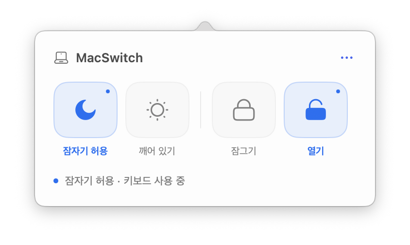

# MacSwitch

**맥북 잠자기와 키보드를 메뉴 막대에서 간단하게 제어하세요.** 무료 MIT 오픈소스 앱입니다.

[English](README.md) · [DMG 다운로드](https://github.com/blackcat199099/macswitch/releases/latest/download/MacSwitch.dmg) · [ZIP 다운로드](https://github.com/blackcat199099/macswitch/releases/latest/download/MacSwitch.zip) · [최신 버전](https://github.com/blackcat199099/macswitch/releases/latest)

macOS 14 이상 · Apple Silicon·Intel 유니버설 앱 · 현재 앱 화면은 한국어입니다.



*위 이미지는 실제 실행 화면을 캡처한 것입니다.*

## 설치는 이렇게 하세요

1. 위의 **MacSwitch.dmg**를 내려받아 열고, **MacSwitch를 Applications(응용 프로그램) 폴더로 드래그**합니다. ZIP 파일로도 받을 수 있습니다.
2. 설치한 앱을 실행하면 화면 오른쪽 위 메뉴 막대에 노트북 아이콘이 나타납니다. 클릭하면 버튼 네 개가 열립니다.
3. 키보드를 잠그려면 앱의 **키보드 잠금 권한 설정**을 누른 뒤, **시스템 설정 → 개인정보 보호 및 보안 → 손쉬운 사용**에서 MacSwitch를 허용합니다. 앱으로 돌아와 ‘잠그기’를 누르세요.

**처음 실행할 때:** 첫 공개판은 로컬 서명된 앱이며 Apple Developer ID 서명과 공증을 받지 않았습니다. macOS가 실행을 차단할 수 있습니다. 소스와 다운로드 체크섬을 확인한 뒤 실행 여부를 결정하세요. 앱별 ‘그래도 열기’ 절차는 [Apple 공식 안내](https://support.apple.com/102445)를 참고하세요. Gatekeeper나 시스템 무결성 보호 기능을 끌 필요는 없습니다.

## 네 아이콘 사용법

| 아이콘 | 기능 | 동작 |
| --- | --- | --- |
| 달 | 잠자기 허용 | `pmset disablesleep 0`으로 평소처럼 잠자기를 허용합니다. 즉시 잠들게 하지는 않습니다. |
| 해 | 깨어 있기 | `pmset disablesleep 1`로 잠자기를 금지합니다. |
| 닫힌 자물쇠 | 잠그기 | 키보드 입력을 차단합니다. 마우스와 트랙패드는 계속 사용할 수 있습니다. |
| 열린 자물쇠 | 열기 | 입력 차단을 해제합니다. |

**파란색 아이콘과 작은 점이 현재 활성 상태**입니다. 잠자기 두 버튼과 키보드 두 버튼은 각각 한쪽만 활성화됩니다. 마우스를 올려두면 설명이 나타납니다. 잠자기 상태는 실제 시스템 설정을 읽어 표시합니다.

**비상 해제: Esc 키를 1.5초 안에 세 번 누르세요.** Esc를 길게 누르는 자동 반복은 횟수에 포함하지 않습니다. 마우스로 열린 자물쇠를 누르거나 앱을 종료해도 키보드 차단이 해제됩니다.

## 알아두면 좋은 점

- 잠자기 설정 변경 시 **macOS 관리자 인증**이 필요할 수 있습니다. 앱이 암호를 직접 입력받거나 저장하지 않습니다. 관리자 권한으로 실행되는 명령은 위의 고정된 `pmset` 명령 두 개뿐입니다.
- 선택한 잠자기 설정은 **앱을 종료하거나 Mac을 재시작해도 유지**됩니다. 다시 잠자기를 허용하려면 달 아이콘을 누르세요.
- 키보드 차단은 앱 종료, Mac 잠자기, 사용자 전환 또는 차단을 유지할 수 없는 상황에서 해제됩니다.
- 전원 버튼·Touch ID·로그인 화면·macOS가 보호하는 암호 입력은 차단 범위 밖입니다. 보호된 입력이 켜져 있으면 잠금을 시작하지 않으며, 잠금 중 켜지면 차단을 해제합니다.
- 연결된 외장 키보드를 포함한 현재 사용자 세션의 키보드 입력에 적용됩니다.

업데이트 뒤 권한 안내가 계속 보이면 기존 MacSwitch 항목을 **−로 제거**하고, **+로 현재 설치한 앱을 다시 추가**하세요. DMG로 설치한 앱은 보통 `/Applications/MacSwitch.app`, 소스 설치 스크립트로 설치한 앱은 `~/Applications/MacSwitch.app`에 있습니다. 이후 앱을 다시 실행합니다. [Apple 권한 안내](https://support.apple.com/guide/mac-help/mh43185/mac)도 참고할 수 있습니다.

## 이미지로 보는 사용법

[한국어 사용법 이미지](docs/assets/quickstart-ko.png) · [영어 사용법 이미지](docs/assets/quickstart-en.png)

안내 이미지 두 장은 ImageGen으로 제작했습니다. 실제 캡처는 `screenshot-live*.png`, 생성한 안내 이미지는 `quickstart-*.png`로 구분했습니다. [생성 프롬프트](docs/IMAGEGEN-PROMPTS.md)도 공개합니다.

## 개인정보

로그인·분석 도구·서버·키보드 입력 기록 기능이 없습니다. 입력 차단과 비상 해제 판단을 위해 키보드 이벤트를 메모리에서 처리하며, 입력 내용을 저장하거나 전송하지 않습니다. 기본 기능은 오프라인으로 동작합니다. 아이콘 출처 메뉴를 선택하면 브라우저에서 Reicon 웹사이트를 엽니다.

공개 대상 파일과 배포 파일의 개인정보·비밀 값 점검 결과는 [공개 전 점검 기록](docs/PRIVACY-REVIEW.md), 동작 확인 범위는 [검증 기록](VERIFICATION.md)에 정리했습니다.

## 직접 빌드하기

Swift 6 이상이 포함된 Xcode를 설치한 뒤 실행합니다. 외부 패키지 의존성은 없습니다.

```sh
git clone https://github.com/blackcat199099/macswitch.git
cd macswitch
bash Scripts/test.sh
bash Scripts/build.sh
```

결과물은 `artifacts.nosync` 폴더의 `MacSwitch.dmg`, `MacSwitch.zip`, `SHA256SUMS.txt`입니다. Apple Silicon·Intel 두 버전을 함께 빌드하고, 디버그 기호와 원본 경로를 정리한 뒤 iCloud 밖에서 서명합니다.

소스에서 빌드한 앱은 `bash Scripts/install.sh`로 사용자 응용 프로그램 폴더에 설치할 수 있습니다. 실행 중인 앱은 먼저 종료하세요. 새 빌드는 권한을 다시 허용해야 할 수 있습니다.

## 라이선스와 출처

앱 코드와 직접 작성한 문서는 [MIT 라이선스](LICENSE)로 공개합니다.

아이콘은 [Reicon](https://reicon.dev/icons)을 사용했습니다. Reicon MIT 라이선스와 기반 Solar Icons의 CC BY 4.0 표기는 [ThirdParty](ThirdParty/NOTICE.md)와 앱 안에 유지합니다. 앱의 MIT 라이선스가 외부 에셋의 별도 이용 조건을 대체하지 않습니다.
