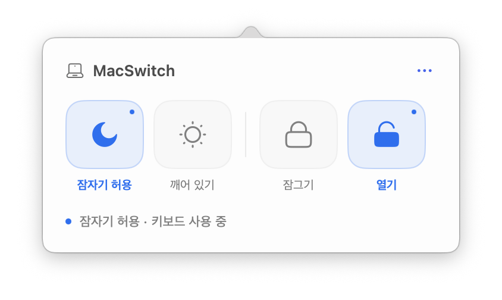

# MacSwitch

**Sleep and keyboard controls in your Mac's menu bar.** Free, small, and open source.

[한국어 안내](README.ko.md) · [Download DMG](https://github.com/blackcat199099/macswitch/releases/latest/download/MacSwitch.dmg) · [Download ZIP](https://github.com/blackcat199099/macswitch/releases/latest/download/MacSwitch.zip) · [Latest release](https://github.com/blackcat199099/macswitch/releases/latest)

macOS 14+ · Universal binary for Apple Silicon and Intel · MIT-licensed code



*Actual app capture. The controls use Korean labels; password guidance supports Korean and English. The English guide maps the same four icons.*

## Download and install

1. Download **MacSwitch.dmg** from the links above. Open it and drag **MacSwitch** into **Applications**. A ZIP is available if you prefer.
2. Open the installed app. Click its laptop icon at the top-right of the menu bar.
3. For keyboard locking, use the permission link in the app and enable **MacSwitch** in **System Settings → Privacy & Security → Accessibility**. Then click the closed lock again.

**First-launch signing:** this release is ad-hoc signed, without Apple Developer ID signing or Apple notarization. macOS may block its first launch. Review the source and download checksums before deciding whether to allow it. Apple's [official first-launch instructions](https://support.apple.com/102445) explain the per-app **Open Anyway** option. MacSwitch does not require disabling Gatekeeper or System Integrity Protection.

## Four icons

| Icon | Korean label | What it does |
| --- | --- | --- |
| Moon | 잠자기 허용 | Allows normal sleep using `pmset disablesleep 0`. Does not sleep immediately. |
| Sun | 깨어 있기 | Prevents sleep using `pmset disablesleep 1`. |
| Closed lock | 잠그기 | Filters keyboard input. Mouse and trackpad remain usable. |
| Open lock | 열기 | Removes the keyboard input filter. |

Blue icons and small dots show the active state. The two sleep controls form one pair; the two keyboard controls form another. Hover for a description. Sleep state is read from the real system setting.

**Emergency unlock: press Esc three times within 1.5 seconds.** Holding Esc does not count as three presses. You can always use the mouse to click the open lock. Quitting the app also removes its input filter.

## Permissions and behavior

- **Mac login password:** the app now says “Enter your Mac login password.” in English or “Mac 로그인 암호를 입력해 주세요.” in Korean, based on your Mac’s preferred language. macOS owns the dialog buttons and field labels, which follow the system language. An administrator account may be required to change sleep settings. The only privileged commands are the two fixed `pmset` commands above. MacSwitch does not collect or store your password.
- **Accessibility:** needed to filter keyboard events in the current user session. See [Apple's permission guide](https://support.apple.com/guide/mac-help/mh43185/mac).
- **Persistent sleep setting:** your chosen `pmset` setting remains after quitting or restarting. Click the moon to restore normal sleep.
- **Automatic keyboard release:** the filter is removed when the app quits, the Mac goes to sleep, the user session becomes inactive, or macOS prevents the filter from operating.
- **Protected input:** power, Touch ID, the login screen, and macOS secure password input are outside the filter's scope. Secure input prevents keyboard locking; if it starts during a lock, the app releases the lock.
- **All session keyboards:** the filter affects keyboard input in the user session, including connected keyboards. It is not limited to the built-in keyboard.

After updating a locally signed build, macOS may require Accessibility permission again. If toggling the old entry does not work, remove it with **−**, use **+** to add the app you actually installed, and reopen MacSwitch. The source installer uses `~/Applications/MacSwitch.app`; drag-and-drop installation normally uses `/Applications/MacSwitch.app`.

## Illustrated quick starts

[한국어 이미지](docs/assets/quickstart-ko.png) · [English image](docs/assets/quickstart-en.png)

These two illustrated guides were created with ImageGen. Real app captures are named `screenshot-live*.png`; generated guides are named `quickstart-*.png`. [Generation prompts](docs/IMAGEGEN-PROMPTS.md) are included.

## Privacy

MacSwitch has no analytics, account, backend, or keyboard-content log. Keyboard events are processed in memory to block input and recognize recovery keys; their contents are not stored or sent anywhere. The app works offline. Choosing its Reicon credit opens the icon library website in your browser.

See the [public-release privacy review](docs/PRIVACY-REVIEW.md) and [verification notes](VERIFICATION.md) for what was checked and the limits of that review.

## Build from source

Install Xcode with Swift 6 or newer, then:

```sh
git clone https://github.com/blackcat199099/macswitch.git
cd macswitch
bash Scripts/test.sh
bash Scripts/build.sh
```

The build creates `artifacts.nosync/MacSwitch.dmg`, `MacSwitch.zip`, and `SHA256SUMS.txt`. It builds both CPU architectures, strips debug symbols, remaps source paths, and signs in a temporary folder outside iCloud. There are no external package dependencies.

To install a source build in your user Applications folder:

```sh
bash Scripts/install.sh
```

Quit a running MacSwitch before replacing it. The installer checks the existing bundle identity and refuses to overwrite an unrelated app. Rebuilds may require regranting Accessibility permission.

## License and credits

MacSwitch code and original documentation are released under the [MIT License](LICENSE).

Icons are from [Reicon](https://reicon.dev/icons). Their upstream MIT license and Solar Icons / CC BY 4.0 attribution are retained in [ThirdParty](ThirdParty/NOTICE.md), and included in the app bundle. The MIT license for MacSwitch does not replace third-party asset terms.
